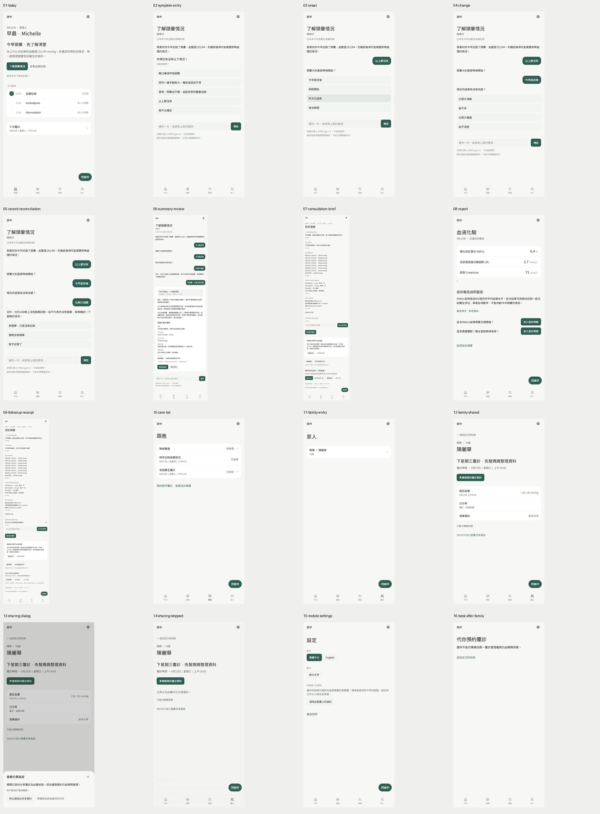
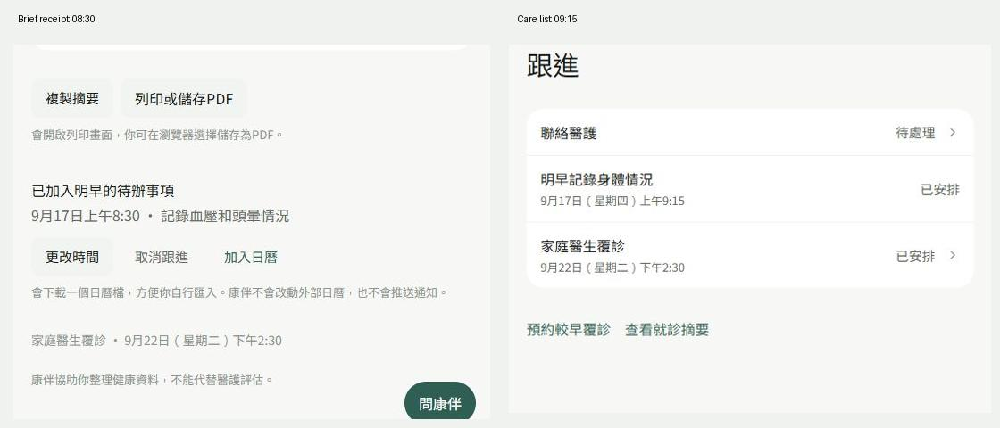
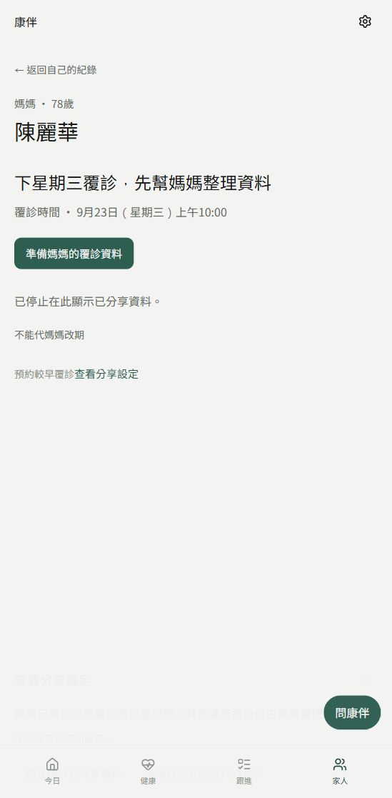

# CareMate HK：当前审查证据与无引导用户测试方案

日期：2026-10-03（Asia/Hong_Kong）  
配套：[设计分析](../specs/2026-10-03-caremate-complete-demo-design.md) · [实施计划](../plans/2026-10-03-caremate-complete-demo.md)

## 1. 当前结论和证据范围

现有 demo 有完整的单一头晕故事基础，已有测试通过。它还未覆盖 PDF 的完整身心、授权和家属响应旅程，也未达到无引导用户测试验收。当前浏览器审查确认：跟进时间矛盾、停止分享后仍显示预约、手机控制入口缺失以及家人上下文残留。

本轮只新增规划文档与截图，未修改产品源码、测试或配置。生产服务器来自`npm run build`后的`npm run start -- --hostname 127.0.0.1 --port 3000`。手动走查使用 Codex in-app Browser，视口为549×1117 CSS px；长页截图宽度534px是滚动条占用后的full-page捕获。没有将此视口称为390px手机验收。

采用虚构的已有Michelle／Lai-wah资料作为**当前状态证据**；设计提案将产品主测试角色改为PDF的May／David。所有手动动作只用quick replies和本地保存，没有提交真实AI推理请求；页面当前会显示HKBU ready信息，这正是待移除边界的证据。

当前截图不证明完整可访问性、全部屏幕适配、任意输入安全或真人可用性。下方明确把实际结果与后续目标分开。

## 2. 已执行验证

| 检查 | 实际结果 | 证明什么／限制 |
| --- | --- | --- |
| `npm run lint` | exit0，0 errors，4 warnings | 未使用变量：selectors的allergy、store的toast/pendingPath/hydrated |
| `npm run build` | exit0，Next16.3.5／Turbopack，TypeScript通过，25/25静态生成任务 | 正常生产构建成功；`/api/ask`仍为dynamic route |
| `npx playwright test --list` | 7文件，58项 | 33项纯逻辑、25项浏览器测试 |
| 首次E2E | 33 pass、19浏览器启动fail、6 not run | 缺少Playwright Chromium headless shell；尚未执行app断言，不计UI缺陷 |
| `npx playwright install chromium` | exit0 | 官方v1243与支持二进制安装到正常用户cache；无npm依赖或源码变更 |
| `npm run test:e2e -- --project=chromium --workers=1` | **58 passed，17.8s，0 failed／skipped／not run** | 复用生产服务器；自动化已有断言通过 |
| 手动走查 | 16个截图步骤保存并查看，末次console error/warn为空 | 当前被走过的路径；不证明其他路径没有错误 |

### 现有测试覆盖

| 测试文件 | 数量 | 内容 |
| --- | --- | --- |
| `tests/ask-llm.spec.ts` | 20 | classification、记录packet、长度、unknown、隔离、sanitising |
| `tests/journey-copy.spec.ts` | 6 | 回答相关文案 |
| `tests/shell-layout.spec.ts` | 7 | 路由和shell状态 |
| `tests/demo-flow.spec.ts` | 7 | 主录影线、拒绝提醒、家人、预约、紧急、390/430 overflow |
| `tests/demo-quality.spec.ts` | 9 | 更正、加剧、自由输入、网络响应／重试（mock）、console |
| `tests/emergency-cjk.spec.ts` | 4 | 中文求助、字体、本地ready、返回紧急 |
| `tests/pages-session.spec.ts` | 5 | 跨session、保存、reset、紧急导航 |

质量测试使用`page.route('/api/ask', ...)`拦截响应；ready测试仅向本地发送GET。**这些测试通过不等于真实AI能力经过验证，也不等于demo符合当前零后端要求。**

当前`trace: on-first-retry`与`retries:0`组合不能保存失败重试trace。实施Task10改为`retain-on-failure`。GitHub Pages workflow当前只build/export，没有lint、E2E、a11y门槛；本轮没有build并验证静态basePath模式。

## 3. 当前16步截图审查

截图均来自本轮实际操作，按保存顺序排列。完整原图位于`docs/superpowers/evidence/2026-10-03/`；画面概览：

| 步骤 | 页面／动作 | 该步健康状况 | 对应截图 |
| --- | --- | --- | --- |
| 01 | 今日，找到头晕入口 | 主要动作清楚；日常心情记录入口缺失 | [01-today](../evidence/2026-10-03/01-today.jpg) |
| 02 | 症状入口／urgent问题 | 选项可操作；HKBU模型信息与纯前端范围冲突 | [02-symptom-entry](../evidence/2026-10-03/02-symptom-entry.jpg) |
| 03 | 选择起始时间 | 可逐步选择；长对话中旧选项没有直接编辑入口 | [03-onset](../evidence/2026-10-03/03-onset.jpg) |
| 04 | 选择症状变化 | 选择后可继续；其他分支本轮手动未走，已有自动测试覆盖部分 | [04-change](../evidence/2026-10-03/04-change.jpg) |
| 05 | 核实服药空缺 | 清楚区分没记录与没服药，是可保留的强项 | [05-record-reconciliation](../evidence/2026-10-03/05-record-reconciliation.jpg) |
| 06 | 摘要审阅后确认保存 | 有来源与动作；主按钮在长对话底部，阅读／确认负担高 | [06-summary-review](../evidence/2026-10-03/06-summary-review.jpg) |
| 07 | 打开完整就诊摘要 | 资料齐全；多任务堆叠，跟进选择在很下方 | [07-consultation-brief](../evidence/2026-10-03/07-consultation-brief.jpg) |
| 08 | 报告→加HbA1c就诊问题→返回 | 问题成功同步；没有phantom第四项报告 | [08-report](../evidence/2026-10-03/08-report.jpg) |
| 09 | 自选09:15后查看提醒收据 | **缺陷：收据仍写08:30**；源代码ICS也硬编码08:30 | [09-followup-receipt](../evidence/2026-10-03/09-followup-receipt.jpg) |
| 10 | 跟进列表 | 09:15已保存，与09矛盾；记录身体task没有打开详情动作 | [10-care-list](../evidence/2026-10-03/10-care-list.jpg) |
| 11 | 家人列表 | 单一人物入口清楚；缺少患者主动授权入口／David视角 | [11-family-entry](../evidence/2026-10-03/11-family-entry.jpg) |
| 12 | 已共享家人资料 | 本人未共享药物不显示；预约与BP可见 | [12-family-shared](../evidence/2026-10-03/12-family-shared.jpg) |
| 13 | 打开分享设置→停止接收 | 短确认sheet与焦点进入可观察；无三级权限或内容预览 | [13-sharing-dialog](../evidence/2026-10-03/13-sharing-dialog.jpg) |
| 14 | 关闭sheet后看停止分享结果 | **缺陷：声称已停止显示，却仍有预约日期和生成摘要动作** | [14-sharing-stopped](../evidence/2026-10-03/14-sharing-stopped.jpg) |
| 15 | 从手机设置查控制项 | 语言和大字可见；没有memory／分享管理入口 | [15-mobile-settings](../evidence/2026-10-03/15-mobile-settings.jpg) |
| 16 | 家人后直接打开已知`/book` | **缺陷：持久化mother context使自己的预约被挡住**；此步为已知深链接检查 | [16-book-after-family](../evidence/2026-10-03/16-book-after-family.jpg) |

### 两个已确认状态问题

相同跟进在两个页面显示不同时间；对比图只裁取已保存原截图中的相应区域，没有重绘产品画面：

停止分享后，预约和摘要入口仍可见：

### 可访问性观察与仍需验证

现有文字选择、列表和分级标题可读，通用sheet实现了部分焦点处理；但截图中的浅灰来源标签存在对比风险，不能仅目测宣称不合格或合格。需要实际计算对比。逐步对话较长，需验证键盘焦点、读屏宣布和返回更正是否能保持上下文。下一轮应测200%缩放、大字、reduced motion和所有modal；本轮未执行这些专项。

缺失／未走查的PDF流程明确列为待实现：首次使用、身心daily check-in、情绪支持、患者三级授权、David接收并响应、覆诊前一天自动草稿、覆诊后分工。已有紧急、预约正常路径和翌日no-dizzy主要由现有自动测试验证；本轮截图没有覆盖所有分支。

## 4. 用户测试方法

目的：判断患者和家属在没有操作说明时能否完成目标、理解状态并从错误中恢复；不是让参与者复述研究员预定路线。

首轮建议6位年长参与者＋4位成年家属。年长组包含中低数字熟练度；家属组包含远距离照顾经历。可包括2对亲子，但独立操作时不互相指导。先用一对试跑任务卡，再确定时间预算；试跑数据单独记录。第二轮用新参与者验证修复，避免把学习效果当可用性提升。

每人做适合角色的5–6项，约45–60分钟。研究员给虚构情境资料，先说明：这是使用假资料的产品原型，没有真实预约、外部通知或医疗判断。无需向参与者讲解菜单或按钮。观察时不指路；求助后可协助继续，但结果记为“有协助完成”。对年长者可任务后询问过程，减少边做边说的额外负担。

场景初始化由研究员在`/dev`完成；正式计时开始后不能scene jump绕过用户动作。各任务用独立快照，避免上一项失败污染下一项。不得声称本轮已经招募或完成真实用户测试。

## 5. 无提示任务卡（给参与者只读目标列）

| #／角色 | 参与者目标 | 研究员起始快照 | 客观完成结果／检查 |
| --- | --- | --- | --- |
| U1 May | 今天身体有点不舒服，心情也一般。请留下这些情况，让明天的自己能看明白；如果写错，也请改好。 | `routine-day`，当天无check-in | 身体和心情保存；更正后正确；能重新找到；没有新增诊断 |
| U2 May | 最近觉得有些孤单。请看看这里能怎样陪你，并找一件今天愿意做的小事。 | `low-mood` | 获得有限支持并选择下一步；能只记录；不支持输入有继续入口 |
| U3 May | 你想记住今晚要处理的用药事项，并记下今天实际发生的情况。请按给你的虚构药单处理。 | `routine-day`＋明确时间，9月14日晚UNKNOWN | 提醒时间正确；“已服／未知”来源正确；可以更正；不提供剂量建议 |
| U4 May | 原定复诊时间不方便。请选一个方便的时间，再确认这件事现在安排成怎样。 | `dizziness`，9月22日14:30原预约 | 新时段保存，可重新找到、再更改或取消；能说出是app内行程而非真实诊所确认 |
| U5 May | 明天要见医生。请准备能说明最近身体、心情和困扰的资料，检查是否准确，再带走一份。 | `day-before-visit`，一周记录＋一条可更正内容 | 草稿可找到，身心内容正确；审阅确认；复制／打印预览；未自动外发 |
| U6 May | 儿子住得远。你希望他知道需要帮忙的事项，但不希望他阅读全部日常记录。请按这个想法安排。 | `share-needed`，David无授权 | 仅必要提醒＋正确类别；能解释内容；David预览没有原始数值／心情原文 |
| U7 May | 现在你希望以后不再让儿子通过这里查看你的资料。请处理这件事。 | 独立`caregiver-alert`，已有summary／full授权 | 撤销后旧详情、预约、brief和事件不可见；本人记录保留；理解外部保存副本不能收回 |
| U8 David | 你收到妈妈需要留意的消息。请了解你可以查看的情况，并让她知道你是否能够帮忙。 | `caregiver-alert`，alerts-only，pending | 可了解允许的信息，接受／拒绝有收据，May看到相应结果；不把acknowledged当resolved |
| U9 David | 妈妈愿意让你了解最近一周的整体情况。请看看她最近怎样，并判断还有什么需要向她了解。 | `caregiver-alert`，summary授权，mood未分享 | 只看授权趋势和待办；理解信息不足；不能自行扩大权限 |
| U10 May／David | 复诊后有几件接下来要处理的事。请安排由谁、什么时候处理，并留下已经完成的事项。 | `after-visit`，任务卡提供明确虚构安排 | 任务有来源和时间；David接受后才成为owner；完成双方可见，权限外内容不泄漏 |

任务卡不提“按某按钮／去某tab”。完成路径可以与设计者预期不同，只要结果正确。U1、U5、U6、U7是患者核心任务；U8、U9是家属核心任务。

可分配给不同人的额外分支：没有时段、空记录、取消、重复点击、未知服药、clipboard失败、拒绝协助、提醒已处理、降级权限、200%缩放、长英文补充、深链接无授权。紧急分支单独测试：“按照任务卡中的虚构情况，你现在需要立即找人协助；请找出下一步，并说说是谁执行这个动作。”主持人不真实拨打999。

## 6. 记录表与判断方法

每项记录：参与者匿名编号、角色、设备／语言／数字熟练度、scenario版本、开始／结束时间、首次找到入口时间、路径、错误、求助、恢复、结果和理解回答。

结果分类：**独立完成／有协助完成／未完成**。任务后的SEQ问：“你觉得完成刚才这项任务有多容易？”1非常难到7非常容易。另问用户用自己的话描述：预约是否通知诊所、谁能看什么、撤销后什么改变、提醒是否意味着临床问题处理完。

形成性目标：核心任务独立完成率≥90%；各任务SEQ中位数≥6/7；权限、假预约、求助动作没有严重理解错误；没有阻断任务的P0/P1。各角色分别报告实际人数与分母；例如6位患者中5位完成=83%，不是把患者与家属混合补成高分。

这些是本项目目标，不是已测结果，也不代表统计显著或所有用户都易用。任务时间预算由pilot建立，超过预算是诊断信号，不自动等于失败。两轮后仍报告样本、观察限制和未解决问题。

| 严重度 | 判断 | 处理 |
| --- | --- | --- |
| P0 阻断／权限泄漏 | 任务无法完成、未经授权健康内容可见、外部成功严重误解 | 下次测试前修复并回归 |
| P1 严重摩擦 | 经常迷路、错人／错时间、无法恢复、主入口不可发现 | 优先修复，用新参与者复测 |
| P2 可优化 | 更多阅读、额外点击、个别文字理解困难但能完成 | 汇总改进，不为追求漂亮掩盖功能问题 |

## 7. 技术验收矩阵（全部为后续目标）

| 类别 | 验收 | 证据文件／执行任务 |
| --- | --- | --- |
| 功能 | R1–R9／J1–J8及关键分支通过；核心场景0skip；重复操作不重复 | Task1–9 spec tests、Task10 complete-journeys报告 |
| 本地边界 | `/api/ask`及第三方健康服务request为0；所有假资料与静态assets可本地运行 | local-assistant／static-demo network断言 |
| 权限 | alerts-only／summary／full×类别×降级／撤销；已有页面与导出重新验证 | sharing-permissions／caregiver-response |
| 时间 | 09:15统一；跨日、取消、改期后Today／Care／ICS／brief一致 | care-lifecycle／booking／previsit |
| 状态真实性 | unknown不等于missed；保存不等于发送；确认收到不等于完成；预约不等于诊所确认 | 领域断言＋参与者理解核验 |
| 响应式 | 320/390/430/768/1024/1440，所有产品route与重要overlay，两语言／大字／长内容 | screenshots＋overflow／可操作性断言 |
| 可访问性 | 键盘、焦点、dialog、status、图表表格、200%缩放；serious／critical axe=0 | responsive-accessibility报告＋人工记录 |
| 静态导出 | 本地`/Personal_AI_Demo/`路由／assets／直开／刷新正常，纯静态无API | static-demo报告；没有部署授权 |
| 性能 | 各5次冷／暖加载；LCP≤2.5s，CLS≤0.1；实际交互≤200ms，Lighthouse mobile≥90项目目标 | 每次数据和设备条件；不足则定位，不用单次最好值 |
| 真人可用性 | 无提示任务、独立完成、恢复、SEQ与理解核验 | Task11匿名结果与两轮修复记录 |

性能依据为[Google Web Vitals](https://web.dev/articles/vitals)。真实CWV判断看移动／桌面分别的p75；实验室数据不是现场指标。Lighthouse不测INP，不能把TBT替换名称后说INP已通过。此次尚未测量性能。

可访问性参考[WCAG 2.2](https://www.w3.org/TR/WCAG22/)；正常文字对比至少4.5:1、大文字3:1，关键非文字组件按对应要求检查。44×44是本项目触控目标。截图和axe都不能单独证明完整WCAG合规。

## 8. 完成状态用语

目前：**分析、计划和当前baseline验证已完成；完整新demo未实现。**

后续只有技术结果时：**技术验收通过，待无引导参与者测试。**

技术和两轮用户测试之后：**指定范围和测试样本下的验收通过**，附实际结果与限制。避免“体验完美／所有用户都能完成／临床安全已证明”等超出证据的声明。
