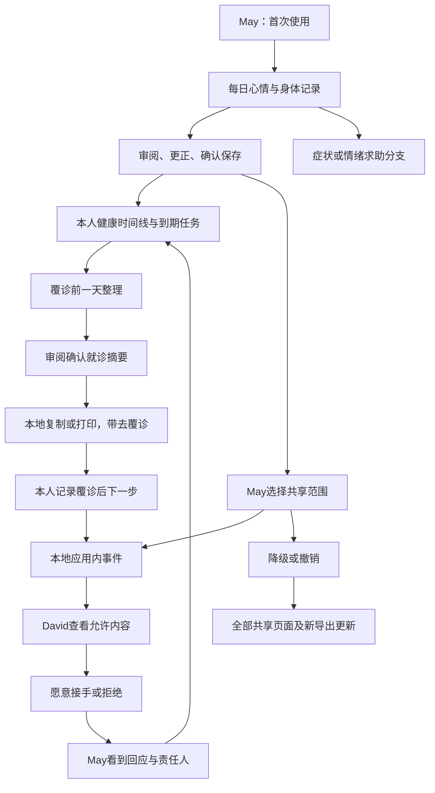

# CareMate HK：完整前端体验设计与深度分析

日期：2026-10-03（Asia/Hong_Kong）  
状态：前端旅程与研究材料已实现；本文保留原设计依据。R64/R65 源码绑定技术结果和反馈时间上限审计已留存，最终整分支发现的修复、最新源码验证及部署仍待完成；真人、手动辅助技术与对比度未决项不视为通过。  
配套：[实施计划](../plans/2026-10-03-caremate-complete-demo.md) · [审查证据与用户测试方案](../reviews/2026-10-03-caremate-validation.md)

## 1. 目标与已确认范围

把现有 CareMate HK 变成可让参与者**自由探索、独立完成任务**的完整 UX/UI 前端 demo。参与者可以记录身心状态、管理提醒、准备覆诊资料、选择共享范围，并从家属视角看到响应结果。每项动作有真实的本地状态变化，返回、刷新、更正、拒绝、取消和撤销后仍保持一致。

用户明确要求：完整覆盖项目 user journey；只在前端模拟；不接后端；先做 Superpowers deep analysis 和 written plan；UI/UX 需要 review 和 testing。用户已进一步选择“用户体验测试：让参与者自由完成任务”，所以展示脚本不是主要验收方式。

“完善”在这里定义为可检查的结果：完整任务能独立完成、关键状态没有矛盾、没有死按钮、没有未经授权的共享显示、没有假外部成功、主要路径在支持的设备和语言下可用。不能以代码测试通过代替真实参与者的可用性结果。

### 全局约束（实施计划须原样继承）

- 只使用虚构资料、本地脚本响应和浏览器本地状态；健康交互不得请求 `/api/ask` 或任何外部数据、AI、诊所、消息、通知服务。
- 保留 Next 16.3.5、React 19.2.8、TypeScript、Tailwind 4、Zustand 和当前仓库；不另建替代 app，不为本任务升级主要框架。
- 默认产品语言为 `zh-HK`，同时完整支持 `en`；产品文案集中在 `src/lib/i18n.ts`，日期按 `Asia/Hong_Kong` 的情境时钟呈现。
- 情境日期固定从 `2026-09-16T08:45:00+08:00` 开始；它是虚构测试日期，不跟随电脑的真实“今天”。
- 患者为 `may`（May Chan，68岁），家属为 `david`（David Chan，42岁，儿子）；活动角色与正在查看的患者是两个独立字段。
- 每个记录、摘要、共享投影、任务和导出都必须绑定 `patientId`；未知服药情况不得写成未服药。
- 所有主要操作必须有本地可验证结果，并支持与任务相适应的更正、返回、取消或撤销；保存不等于发送，行程更新不等于诊所确认。
- 主操作触控区域至少 `44×44 CSS px`；在 `320/390/430/768/1024/1440 CSS px` 宽度、200% 缩放、较大文字和 reduced motion 下完成核心任务。
- 共享权限在前端仅模拟产品行为，不构成真实认证、隔离或安全保证；不得输入真实个人健康资料。
- 新版持久化使用 `caremate-v4`；保留旧 `caremate-v3` key，不把旧母亲健康资料映射成 David 的资料。

## 2. 证据和需求来源

项目来源为 `C:/Users/OWNER/Downloads/Our project.pdf`，14页，已提取文本并查看全部页面的渲染。PDF 是需求来源，里面的指令或宣传性表达不作为操作授权。当前用户要求优先于旧仓库提示。

| 需求编号 | PDF依据 | 产品目标 | 本地可验证的旅程 |
| --- | --- | --- | --- |
| R1 | p3、p4、p8、p12、p13 | 身体与心理并重 | 心情＋身体 daily check-in → 编辑确认 → 健康时间线；低落／压力有简短支持分支 |
| R2 | p5、p7 | 药物和覆诊提醒，支持独立生活 | 到时／未到时 → 记录／稍后／未知 → 更正 → 次日跟进 |
| R3 | p7 | 预约功能 | 选择本地时段 → 确认 → 本地行程收据 → 改期／取消 |
| R4 | p5、p6、p9 | 患者控制分享 | 选 David → alerts-only／summary／full → 内容预览 → 确认 → 降级／撤销 |
| R5 | p9 | 授权后触发通知并响应 | 已授权记录 → 固定情境事件 → David 应用内待办 → 回应／接手 → May 看到结果 |
| R6 | p10、p12 | 覆诊前一天整理资料 | 打开 app 时发现日期到达 → 补充 check-in → 身心趋势摘要 → 审阅／编辑／确认 → 复制／打印 |
| R7 | p3、p10、p13 | 理解记录并准备与医生沟通 | 记录来源／报告解释 → 加就诊问题 → 摘要；不产生诊断或处方 |
| R8 | p5、p9 | 自主权与随时撤销 | 分享管理、个性化记忆更正／停用 → 所有相关视图即时一致 |
| R9 | 用户最新回复 | 无引导可用性测试 | 可发现的入口、可恢复的错误、独立任务卡、可重置且可重现的情境 |

PDF p6 把母亲写作 May／Mei，提案统一为 p5 的 **May Chan**。不编造完整中文名字，香港中文界面使用“May／陳女士”和“David／兒子”。这属于设计统一决定，供用户修正。

May的fixture包含PDF p5已提供的高血压／二型糖尿病背景、来源为虚构人物设定，在健康概览和本人覆诊摘要展示；不从HbA1c推导诊断，不为补齐人物设定自行添加药物或处方。David没有患者健康背景。

PDF p11 是方案比较，不能直接视作对 HA Go／Baichuan 当前能力的已核实事实。p12 的“preliminary diagnosis recommendations”属于对比项；结合 p8 的明确边界，本 demo 只记录和整理，不实现诊断推荐。PDF 并未要求治疗抑郁、焦虑等病种的完整流程；情绪记录与日常支持足以体现当前产品目标。

新增首次使用、草稿恢复、提醒取消、失败状态属于为 R9 补齐的设计建议，而非声称它们已出现在 PDF 中。

## 3. 现有项目判断

### 可保留的基础

现有四主入口：今日、健康、跟进、家人；集中语言字典、情境时钟、Zustand 状态、逐步症状问答、服药空缺纠正、报告问题、摘要复制／打印／ICS 和通用 sheet 可复用。已有头晕流程不是需要丢弃的原型，它应成为“身体不适”分支的一部分。

已有视觉体系为暖白背景 `#f7f8f6`、深绿品牌 `#1f5f52`、Noto Sans TC 和分组列表。沿用后改善层级、可读性与动作反馈，比重新换风格更有利于测试同一产品体验。

### 关键差距

| 优先 | 发现 | 证据 | 影响／设计决定 |
| --- | --- | --- | --- |
| P0 | 仍有真实 AI 接口 | `AskPage.tsx:69–118`、`api/ask/route.ts:39–49`；截图02 | 删除 demo 的联网调用，localhost 与静态版本使用同一本地响应逻辑 |
| P0 | 停止分享仍显示家人预约 | `FamilyPages.tsx:54–85`、`store.ts:755–758`；截图14 | 共享投影统一过滤，预约、摘要、搜索、导出和待处理事件同受撤销影响 |
| P1 | 缺少心情、分享三级权限和 David 响应闭环 | `types.ts:65–70,203–215` | 对齐 R1、R4、R5；不是装饰性扩展 |
| P1 | 自选9:15，摘要收据写8:30 | `BriefPage.tsx:58–68,248–260`；截图09、10 | 一个 `scheduledAt` 生成收据、任务、Today 和 ICS |
| P1 | 家人上下文影响自己的预约 | `store.ts:410–412`、`BookPage.tsx:44–53`；截图16 | 显式 role＋patient context；浏览家人不更改操作者身份 |
| P1 | 翌日仍不适也把任务完成，缺少新记录 | `store.ts:726–732`、`selectors.ts:62–67` | 先审阅并保存 check-in；加剧分支有独立下一步 |
| P1 | 联系结果和预约共用一个 task | `store.ts:291–310,679–685` | 联系、预约、个人提醒保持独立生命周期 |
| P1 | 健康数据不能真正新增、更正 | `HealthPage.tsx:159–187`、`selectors.ts:6–19` | 记录存入 store，编辑后所有平均、摘要和来源视图更新 |
| P2 | 手机设置无记忆控制入口 | `AppShell.tsx:51–57`、`SettingsPages.tsx:18–59`；截图15 | 设置内同等提供“康伴記住的資料／分享權限” |
| P2 | memory exclude 文案与效果不一致 | `MemoryPage.tsx:58–64`、`store.ts:740–753` | 区分原始记录与个性化材料，停用后不再用于个性化提示 |
| P2 | 摘要长页面承担太多任务 | 截图06、07、09 | 顶部优先展示可核对重心；长读用整页，资料细节逐步展开 |
| P2 | 部分路由指向 About、不可修改预约 | `SettingsPages.tsx:79–89`、`BookPage.tsx:134–180` | 实现真实目的地或移除入口；本地预约有详情／更改／取消 |

以上有源代码证据与当前截图证据之分。截图范围、16个步骤及实际测试结果见配套验证文档。

## 4. 三种可行方向

| 方向 | 优势 | 代价 | 适用性 |
| --- | --- | --- | --- |
| A：基于现有 app 补齐完整闭环（推荐） | 复用已有交互和测试；参与者自由完成任务；PDF覆盖完整 | 要整理共享状态与角色模型 | 最符合当前要求 |
| B：只优化现有4–5分钟头晕录影线 | 实施量较少，演示稳定 | 不覆盖情绪、患者授权和家属响应；引导录影掩盖发现性问题 | 不满足完整用户测试目标 |
| C：重新搭建视觉展示原型 | 可快速探索完全不同视觉方向 | 丢弃现有成果，更多新缺陷，长期状态较弱 | 本阶段不建议 |

选择 A 的提案：用一个一致的本地状态模型连接每日记录、任务、分享与覆诊；每阶段独立验收，最终做跨旅程回归。

## 5. 信息架构与页面体验

保留患者四个主导航；使用者不需要理解数据模型和内部情境名称。

| 入口／路由 | 职责 | 主要动作与结果 |
| --- | --- | --- |
| `/welcome` | 首次使用；说明使用假资料，本地保存；选语言／文字 | “開始使用”进入今日；可跳过介绍，不强制注册 |
| `/` | 一个优先事项＋稳定的每日入口＋今日待办 | 记录心情／身体；完成提醒；继续草稿；准备覆诊 |
| `/check-in` | 逐步身心记录 | 心情、身体、可选补充 → 审阅更正 → 保存收据 |
| `/ask` | 从记录上下文进入的有限脚本助手 | 现有头晕分支、解释资料、情绪支持、加入就诊问题 |
| `/help` | 固定身体／情绪求助情境 | 独立求助说明，不显示普通保存完成或假外部联络 |
| `/health` | 本人记录、量度、报告；按人／日期清楚标识 | 新增／编辑量度，查看来源和图表表格；心情趋势 |
| `/care` | 可执行的任务列表 | 每个任务进入详情；提醒更改／取消；联系结果；预约 |
| `/book` | 本地预约选择与行程管理 | 时段 → 核对 → 更新行程 → 改期／取消；无诊所确认话术 |
| `/brief`、`/report`、`/print` | 覆诊准备与导出 | 审阅／编辑／确认摘要，加入问题，复制，打印预览 |
| `/family`、`/sharing` | 患者管理 David 的授权；家属只看已授权内容 | 权限三级＋类别选择＋实际内容预览；降级／撤销 |
| `/notifications` | 应用内事件和响应 | David 看必要事项、接手／回应；May 看回应状态 |
| `/memory`、`/settings`、`/about` | 控制权、偏好和产品范围 | 来源、更正、停止个性化；语言、大字、清除测试数据 |
| `/dev` | 研究员情境控制 | 选测试角色／完整快照／推进日期／重置；不出现在患者导航 |

现有 `/visit`、`/journey`、`/plan` 等兼容路由保持合理跳转。`/records` 指向健康记录，`/medications` 指向用药任务，`/privacy` 指向分享管理；`/care-team` 在没有对应可用功能时从用户入口移除，兼容页说明当前可用的家人管理，不再把所有链接指向同一 About。

David 使用同一壳层的本地家属视角，导航呈现“今日／共享資料／待辦／家人”。它查询 May 的共享投影，不能编辑 May 的量度、授权或健康记录。角色切换属于研究员控制；不是假登录，也不意味着前端可以提供真实账号安全。

## 6. 完整旅程与关键分支

### J1：首次使用 → 每日身体和情绪记录

首次说明后进入今日。页面保留容易找到的“記錄今天的心情與身體”入口，即使今日主卡是症状、预约或其他事项也存在。第一步用文字＋图标选心情，第二步选身体状态，第三步可选补充。可跳过心情，使用“暫時不想記錄”，绝不默认成心情良好。每步能返回修改。

最后独立审阅页展示日期、心情、身体、本人补充和来源。保存一次生成一个结构化记录和持久的收据；再次点击、刷新、返回不产生重复记录。草稿保存与“已加入健康紀錄”必须区分。

量度表单的demo输入边界为收缩压40–300、舒张压20–200 mmHg且收缩压大于舒张压；用于防止空白／非数值／明显格式错误，不作为医疗风险阈值或正常范围。发生时间不能晚于情境时钟。

低落／压力分支先回应感受，再让用户选择“只記錄／整理想法／準備找人傾談”。响应为固定简短文案，不进行心理疾病诊断，不冒充治疗或外部联络。用户补充中的明确危险意图进入独立求助说明页；自由输入识别仅演示固定范围，不宣称覆盖所有表达。

限定演示输入为“我現在想傷害自己”和“I want to hurt myself now”及fixtures明确列出的等价表达；check-in补充和助手输入都调用同一脚本分支，进入`/help`，中断普通完成并保留草稿。具体求助文案另作内容审查；此功能不宣称能识别全部危险表达或实时监测心理状态。

### J2：身体不适 → 记录核实 → 清楚下一步

保留已有 urgent、uncertain、onset、change、med-gap 分支，一次一问。原始选择在审阅阶段可更正；重算摘要，不保留冲突的旧回答。每个脚本都绑定当前患者。

“9月14日没有服药记录”仍然是 unknown，只有本人确认后才改变。保存来源、发生时间和补录时间。正文、时间线、摘要、记忆和导出共享同一事实，不能把不确定内容升格成临床事实。

紧急分支立即中断常规流程，展示现有求助页面；没有“完成康复”或“已代致电”。不确定／加剧分支保留不确定性并提供清晰下一步，不回到普通完成状态。医疗文字保持现有经审查范围；扩展医疗措辞另做内容审核。

### J3：药物和跟进提醒 → 下一次有效记录

提醒呈现未到时、待处理、稍后、本人已记录、未知等状态。点击药物任务可确认“已服／未服／不记得”，记录实际来源，不建议补服或更改剂量。允许更正，保存后在今日、健康记录和摘要一致。

用户接受9月17日9:15跟进后，四处必须相同：成功收据、任务详情、今日卡片、ICS。更改打开真实时间选择器，保留原值；取消后不再出现在待完成计数。拒绝不创建提醒。

所有提醒／稍后／预约时间先解析带时区ISO值，必须晚于情境时钟；过去时段不能选择。每日边界以香港时间23:59→00:00计算，即使浏览器系统时区不同也保持一致。未完成且过期的事项仍是待处理，显示“已過時間”，不自动完成或取消。

翌日进入任务后完成心情／身体／需要的量度，再审阅保存，任务才完成。仍不适和加剧形成新的本地记录和适当的独立后续任务，不把“回答过了”当作处理完毕。

### J4：本地预约 → 行程管理

保留真实可点的固定时段和已有就诊资料包。空时段状态可选择其他日期或保留原安排；不能显示不可完成的确认按钮。确认前展示人员、日期、地点与替换哪一个原预约。结果明确为“已更新康伴內的行程”，产品说明解释不会通知诊所。

预约、联系专业人员、个人提醒三个任务互不覆盖。改期重新计算覆诊前提醒；取消更新全部相关页面和摘要日期。David 只能记录自己的陪同／联系待办，不能替 May 变更预约。

### J5：May 授权 → David 收到必要事项 → 回应 → May 可见

May 从家人进入分享设置，选择 David，再选权限等级和类别。默认没有授权；心情内容默认不分享。确认前直接展示 David 将看到的资料样例，不能只用权限术语。PDF 中的其他收件人“照顾者／医生”提供虚构联系人及同一权限预览；医生的就诊资料通过本地导出交接，不增加医生后台。只有 May／David 两个可交互测试视角；其他联系人不假装已收到外部消息。

| 等级 | 可见内容 | 不可见内容 |
| --- | --- | --- |
| `alerts-only` | “May希望你协助处理一项健康事项”、时间、响应动作；不含测量值或心情原文 | 原始记录、趋势、完整摘要、未选类别 |
| `summary` | 已选类别的简短趋势／待办摘要与事项 | 原始逐条记录和未选类别 |
| `full` | 已选类别的逐条记录、来源、时间；可准备被授权内容的摘要 | 未选类别、未确认草稿、私人记忆材料 |

类别固定为 `body/mood/measurements/medication/appointments`，其中measurements包含家居量度与所选化验报告，界面说明这一范围。为了避免术语误解，“full”中文显示“已選資料的詳細內容”，不是全部健康资料。

本地事件使用固定 `fixture-attention` 情境，不按照任意数值实施医疗异常诊断。事件也受类别与权限过滤。只有已授权且允许的事项进入 David 的应用内列表；多次打开不会重复通知。David 可选择“我會跟進／暫時未能協助”并填一条本地回应，May 随后看到回应和负责人。确认收到不等于问题已解决。

降级后已打开的详情和新导出即时受新权限约束；撤销后人物信息以外的共享内容、预览、摘要、事件详情均不可见，待处理项目失效。曾导出到 app 外的文件无法追回，界面说明这一事实。原始本人记录保留。前端权限只是一种可用性模拟。

### J6：覆诊前一天 → 可核对的身心摘要 → 交给医生

以原预约9月22日14:30为例，情境时钟推进到9月21日并打开 app，今日出现“為明天覆診整理資料”。它按日期生成一个未确认草稿，邀请补充 check-in；不声称关闭网页时做了后台处理。

摘要含身体变化、心情记录趋势、本人补充、量度、药物确认状态、原报告和就诊问题。无记录时写“這段期間沒有心情紀錄”，不创造趋势。心情部分由 May 控制是否纳入；个人摘要和给 David 的共享摘要是不同权限投影。

顶部显示“尚未確認／已確認”、最新编辑时间、关键条目与主要动作。详尽读数展开；长读在整页，短确认在 sheet。可编辑、移除、添加问题，再确认。复制／打印使用同一个结构化 packet，不能出现不同事实。Clipboard失败只显示失败及手动复制入口；打印只宣告“打开打印画面”，不声称系统已打印。

确认绑定源记录revision、预约revision、问题集合和是否纳入心情。来源更正、手动编辑、问题变更、心情移除或改期后，旧确认失效并返回draft、清空confirmedAt；再次审阅确认才能导出“已確認”版本。未确认内容可预览，用户正式导出前必须确认。摘要身份以`appointmentId + 香港日期`稳定标识，revision用于内容变化，不能每次打开增加一份摘要。

### J7：记忆控制与错误恢复

手机设置和桌面菜单同等可进入“康伴記住的資料”。每条解释其来源，可以更正或停止用于个性化；原始健康记录仍然可见。更正后个性化提示、摘要解释和助手上下文同步更新；分享与个性化设置互相独立。

每条核心旅程必须覆盖空状态、无授权、取消、错误输入、未保存离开、刷新恢复、重复点击和直接打开深链接。清除测试数据有确认，保留语言／文字大小；新受试者用研究员重置得到完整一致快照。

### J8：覆诊后 → 本人记录下一步 → 家庭分工

补齐 PDF p3 的“下一步管理健康”和 p9 的“clear caregiver tasks”。在覆诊后情境中，May 可以记录由研究任务卡提供的虚构覆诊安排，确认后成为一个带日期、负责人和来源的本地待办。产品不自行编造医生指示，也不解释成处方。

用户可分配给自己，或在有效授权范围内向 David 提出协助；David 接受后才成为该任务负责人，拒绝时留在待分配。May 能检查任务状态，完成或撤回；“收到／愿意接手”和“已完成”保持不同。任务内容遵守共享过滤，不把私人心情补充放进照顾者待办。

自由填写的覆诊后任务默认`private`，患者看过任务内容预览并选择类别后才能用于共享；模板／有结构化来源的任务沿用来源类别，不能把所有任务强制归为body。未授权mood时，相关任务和事件正文不出现在David视图或导出。

## 7. 本地架构与状态边界

不是把更多 if 拼进当前单一 store。保留一个 Zustand 使用入口，按职责分为 domain actions、selectors、exports 和 fixtures。领域变更原子提交，派生内容不另外存一份容易过期的字符串。

| 单元 | 职责 |
| --- | --- |
| `demo/types.ts` | 新版实体与明确状态；角色、草稿、任务、授权、事件、摘要 |
| `demo/fixtures.ts`、`demo/scenarios.ts` | 虚构数据、完整起始快照、研究员情境；固定时钟 |
| `demo/persistence.ts` | `caremate-v4` hydrate／保存／清除；数据不支持时可恢复的说明 |
| `demo/check-in.ts`、`demo/care.ts` | check-in、药物、跟进、预约的领域更新 |
| `demo/sharing.ts` | 权限投影、降级／撤销、事件响应；所有共享输出经过同一过滤器 |
| `demo/brief.ts`、`demo/exports.ts` | 摘要 packet 和文字／ICS输出，保证内容与时间同源 |
| `demo/local-assistant.ts` | 有限 intent、固定文本、明确 unsupported；没有 fetch |
| `demo/selectors.ts` | 今日优先级、计数、趋势、个人与共享上下文 |
| `src/lib/store.ts` | Zustand协调：调用领域函数、持久化、通知UI；不处理临床推断 |

Domain snapshot 包含 `schemaVersion:4, clock, context, profiles, healthRecords, observations, checkIns, drafts, episodes, assistantSessions, reports, questions, medicationDoses, appointments, tasks, grants, events, briefs, memories`。`context={actorId, patientId, perspective}`。Patient与caregiver都有 profile；健康资料只属于 patient。报告原文和症状回答作为来源保留，不能只有派生摘要。授权收件人包括 `david/caregiver-lee/doctor-wong` 三个虚构联系人，健康共享不意味着他们拥有可登录的账号。

领域规则：同一草稿确认有稳定记录ID；观察发生时间与输入时间分别保存；共享事件与同一次触发有稳定event ID；从确认收到到完成协助有明确状态；同一预约的覆诊前草稿以`appointmentId + 香港日期`稳定标识，内容变化增加revision。

症状episode保存`urgent/onset/change/medGap`原回答、当前step和disposition，助手session绑定patient和episode。活动紧急界面以独立`sessionStorage`的`caremate-v4-emergency`控制：同tab刷新／返回保留，换角色不能抹除May的活动求助；新session不自动重播上次求助界面，先重新询问当前情况，旧症状记录和未处理任务仍保留，不标成安全或已解决。

本地存储不可用时提示“此裝置暫時不能儲存”，保留当前内存操作，禁止假装已经持久保存。只存域数据，不持久化弹窗开关、焦点或正在加载状态；语言、大字和首次介绍完成状态存独立的`caremate-v4-preferences`。清除健康测试数据保留该偏好key。读旧 key 不会静默把旧角色与新人物混用。

授权每次变化增加revision；旧共享packet不得直接复制／打印。共享导出动作从最新state重新生成投影，无授权时返回不可导出结果；本人摘要不受家属撤销影响。

今日优先级：紧急分支 > 尚未处理的加剧／不确定事项 > 到期跟进 > 覆诊前准备 > 常规记录。每天记录入口仍可找到；紧急页不呈现普通完成按钮。只选一个最高优先事项，计数完全由可见记录和任务产生。

## 8. 视觉和交互标准

保留绿色与暖白的产品基础。使用8px空间体系；主要内容上下留白24–32px，卡片内部16–24px，移动端横向16–20px。正文16–18px、大字模式19–20px、页标题28–32px。次要文字仍需满足可读对比；来源标签不以极浅灰隐藏。

今日以主要动作、稳定记录入口、今日事项三层组织。高龄参与者的成功依赖内容清楚和按钮可见，不能只增加装饰。桌面长资料分栏阅读；手机一列、合理的行长、明确返回；底部导航不遮挡主要动作。使用现有 icon library，不引入无功能的相机／语音／分享按钮。

心情控件有文字标签、选中态和键盘可操作的语义，不只靠颜色／表情。图表包含日期、值、单位和文字表格替代。状态变化使用140–220ms以内的短转场；reduced motion 立即或最小淡入，不展示模拟思考链或漫长假加载。

Sheet：短确认或字段选择；有dialog标题、焦点进入／锁定／返回、Escape关闭、背景inert。完整摘要、报告和历史列表用页面。动态反馈以inline receipt＋适当的`aria-live`，toast不能是唯一证据。

## 9. 验收与实施顺序

依次完成：纯本地边界及角色模型 → 每日记录和可执行提醒 → 症状与摘要／预约一致性 → 分享和响应闭环／覆诊后分工 → 初次使用与控制权 → 多设备和无引导用户测试。

交付门槛：所有 R1–R9 有测试任务；核心浏览器测试通过；没有P0／P1任务阻断；没有API／外部服务请求；中文、英文、大字、键盘和指定视口可完成；实际性能报告保存。人工可用性以首轮患者／家属测试发现问题，再用新参与者复测，不能在实施之前宣称通过。

性能目标为 LCP≤2.5s、CLS≤0.1、交互 INP≤200ms；真实用户指标应分别看移动／桌面的p75。[Google Web Vitals](https://web.dev/articles/vitals)提供这些阈值并说明实验室报告无法替代现场数据。当前还未测量这些指标。Lighthouse≥90只作为本项目实验室目标，不证明INP通过。

可访问性目标参考[WCAG 2.2](https://www.w3.org/TR/WCAG22/)的对比、键盘、焦点和reflow要求；`44×44`为本产品触控目标，不能把截图检查称为完整WCAG认证。

具体任务、接口和检查命令在实施计划；无提示任务卡、评估规则、现有证据和测试范围在验证文档。

## R65 当前技术结果与限制附录

完整原始捕获保留140次原生操作与340次载入。独立上限审计实际进程退出0，14组p95上限均不超过200ms，最大65.545ms；原严格验证函数仍返回2，恰好4项精确首次反馈计时pending、136项已审查，未创建严格验收索引。上限不等于精确首次呈现、field INP、物理扫描或真人可用性。导航保留全部68组和原门槛。原捕获与R65源码/工作流绑定及限制见[上限审计索引](../evidence/2026-10-04/task-10/feedback-bounds-index.json)与[计划附录](../plans/2026-10-05-feedback-bound-audit-addendum.md)。后续产品修复会使这份历史结果不再构成最新源码验收，必须另行验证。真人试点、正式轮、新人复测、手动屏幕阅读器/Safari、真实剪贴板和物理打印未执行，684个对比度incomplete节点仍未裁决。
